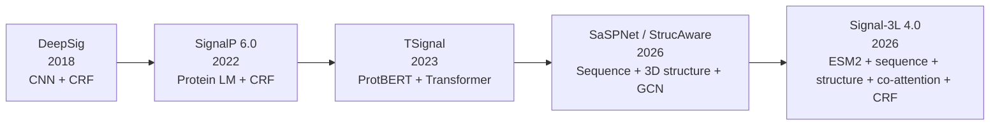

# SP Prediction: Comparative Review of Five Key Papers by Sajjad

> Everying started from DeepSig analysis: [DeepSig_connected](https://www.connectedpapers.com/main/f5655e2d2c16774c33b17e5a151352a8dfd82255/DeepSig%3A-deep-learning-improves-signal-peptide-detection-in-proteins/graph)
>
> So we analyze: DeepSig (2018), SignalP 6.0 (2022), TSignal (2023), SaSPNet
> / StrucAware (2026), and Signal-3L 4.0 (2026).
>
> To understand the main challenges and best architectures!

--------------------------------

## one picture

The progression is roughly:

| Paper | Main representation | Output mechanism | Main research emphasis |
|---|---|---|---|
| **DeepSig** | Learned local sequence features | CNN + structured prediction / CRF | Deep learning for SP detection + cleavage |
| **SignalP 6.0** | Protein-language-model embeddings | CRF | Better generalization + rare SP types |
| **TSignal** | ProtBERT contextual embeddings | Transformer encoder/decoder | Remove hard-coded SP structure and learn it directly |
| **SaSPNet** | ESM-2 + sequence + predicted 3D structure | CNN/BiLSTM/GCN + multimodal fusion | Minority SP classes |
| **Signal-3L 4.0** | ESM2 + sequence + predicted structure | Co-attention + CRF + CB-LDAM | Class imbalance + cleavage + multimodal fusion |

### My favorite: SaSPNET. OverEngineered?

# Results

## Overall classification results

### Reported MCC values

| Model | MCC1 | MCC2 | Context |
|---|---:|---:|---|
| **DeepSig** | ~0.86 | — | Eukaryotic SPDS17 independent test |
| **SignalP 6.0** | **0.8532** | **0.8263** | TSignal benchmark |
| **TSignal** | **0.8520** | **0.8312** | TSignal benchmark |
| **SaSPNet** | ~0.90 overall | — | Its benchmark; especially focused on minor classes |
| **Signal-3L Foldseek** | **0.884** | **0.861** | Signal-3L benchmark |
| **Signal-3L FoldExplorer** | **0.891** | **0.865** | Signal-3L benchmark |

---

## Cleavage-site prediction — the most useful cross-paper comparison

This is the metric I would emphasize for this project because classification is already quite strong in modern models.

| Model | Cleavage metric | Overall / Eukaryote result | Important difficult-class result |
|---|---|---:|---|
| **DeepSig** | Cleavage F1 | **Euk: 0.72** | Gram−: 0.36 on SPDS17 |
| **SignalP 6.0** | Weighted CS F1 | **0.7976** | Improved precision across categories; rare classes explicitly evaluated |
| **TSignal** | Weighted CS F1 | **0.8127 ± 0.005** | Better than SignalP6 for many SP-type/organism combinations |
| **SaSPNet** | CS F1 | ~0.788 overall | **~0.850 minor-class CS F1** |
| **Signal-3L Foldseek** | Macro exact-match CS F1 ±0 | — | **Sec/SPI 0.688, Sec/SPII 0.927, Tat/SPI 0.615** |
| **Signal-3L FoldExplorer** | Macro exact-match CS F1 ±0 | — | **Sec/SPI 0.689, Sec/SPII 0.924, Tat/SPI 0.603** |

---

## Signal-3L 4.0 — direct class-level comparison

### Exact cleavage-site F1, ±0 residues

| Model | Sec/SPI | Sec/SPII | Tat/SPI |
|---|---:|---:|---:|
| SignalP 6.0 | 0.638 | 0.818 | 0.557 |
| Signal-3L Foldseek | **0.688** | **0.927** | **0.615** |
| Signal-3L FoldExplorer | **0.689** | **0.924** | **0.603** |
| Foldseek gain vs SignalP6 | **+0.050** | **+0.109** | **+0.058** |
| FoldExplorer gain vs SignalP6 | **+0.051** | **+0.106** | **+0.046** |

**Interpretation:** Sec/SPII shows the largest improvement, while **Tat/SPI remains the weakest of these three classes**.

---

## Signal-3L unconditional vs conditional cleavage prediction

Signal-3L separates two questions:

- **Unconditional:** predict the cleavage site without requiring the global SP type to be correct.
- **Conditional:** evaluate cleavage only when the SP type was correctly identified.

| Model | Sec/SPI | Sec/SPII | Tat/SPI |
|---|---:|---:|---:|
| Foldseek — unconditional | 0.727 | **0.945** | 0.640 |
| FoldExplorer — unconditional | 0.730 | **0.941** | 0.635 |
| Foldseek — conditional | 0.824 | 0.990 | **0.686** |
| FoldExplorer — conditional | 0.821 | **0.991** | 0.635 |

This is useful because it shows that **cleavage localization itself can be much better once the correct SP class is known**.

---
A representative imbalance is visible in SaSPNet:

| Class | Approx. fraction |
|---|---:|
| NO-SP | **77%** |
| Sec/SPI | 12.73% |
| Sec/SPII | 7.96% |
| Tat/SPI | 1.80% |
| Tat/SPII | 0.16% |
| Sec/SPIII | 0.34% |

# summery

| Paper | Takeaway |
|---|---|
| **DeepSig (2018)** | Deep CNNs can learn SP sequence patterns and improve detection/cleavage, but the model era is still largely sequence-feature driven. |
| **SignalP 6.0 (2022)** | Protein language models dramatically help generalization and especially underrepresented SP types. |
| **TSignal (2023)** | A Transformer can learn SP structural patterns directly instead of relying on hard-coded N/H/C structure. |
| **SaSPNet (2026)** | 3D structure adds useful complementary information, particularly for minority SP classes and their cleavage prediction. |
| **Signal-3L 4.0 (2026)** | Better sequence–structure interaction and imbalance-aware learning can improve both classification and cleavage, but sequence remains the dominant information source. |

