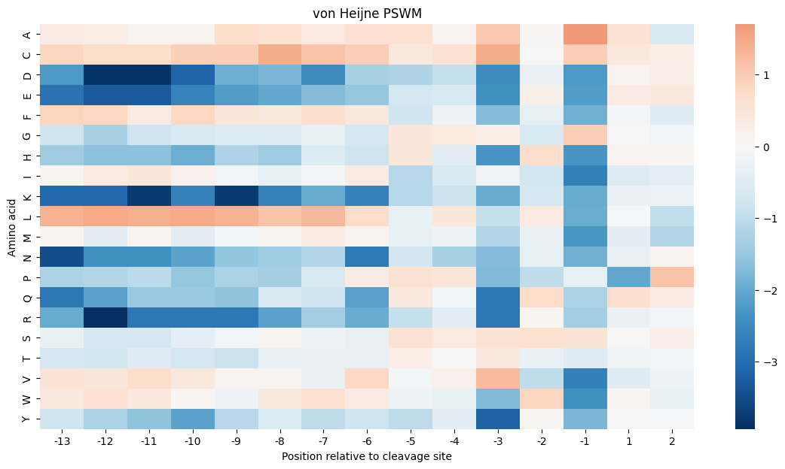
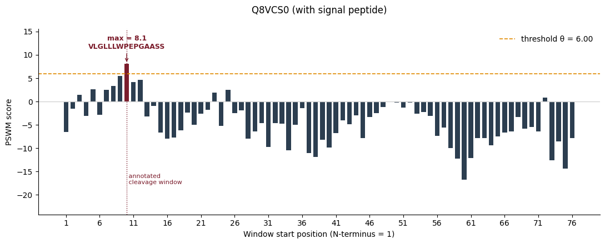
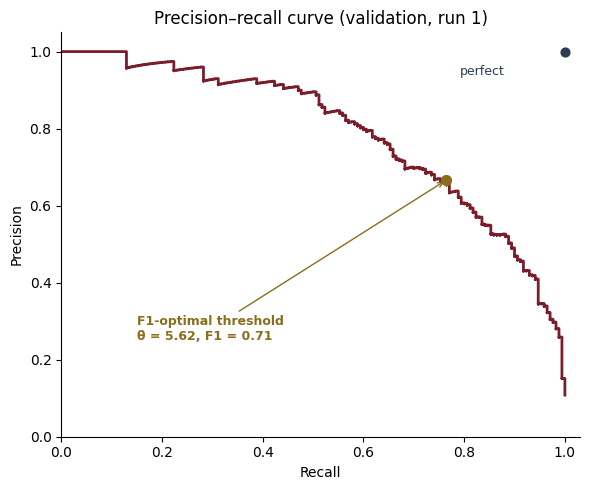

## Steps from modeling to Evaluation

Step 1 — Finalize the models (pages 2–3)
- Select SVM hyperparameters using 5-fold cross-validation on the training set.
- Select the von Heijne decision threshold using the validation set.
- Retrain both final models on the full training set.
- Evaluate each model on the benchmark set once.


Step 2 — Analyze prediction errors (page 4)
- Identify false positives (FP): non-SP proteins predicted as SP.
- Identify false negatives (FN): SP proteins predicted as non-SP.
- Investigate whether errors are distributed differently across taxa and species.
- Perform the same analysis for both methods and compare them.


Step 3 — Investigate false positives (page 5)
- Isolate benchmark false positives.
- Use UniProtKB metadata to calculate the fraction of FPs with a TM helix within the first 90 residues.
- Explain why hydrophobic TM helices can be confused with signal peptides.


Step 4 — Investigate false negatives (pages 6–7)

For von Heijne:
- Generate a sequence logo for the missed signal peptides.
- Compare it with the expected cleavage-site logo.
For SVM:
- Compare N-terminal amino-acid composition.
- Compare signal-peptide lengths.
- Compare other adopted features.
- Use training positives, benchmark true positives, and benchmark false negatives as the three groups.

Step 5 — Summarize the findings (page 8)

Explain the errors rather than merely counting them. Discuss TM helices, cleavage-site context, N-terminal composition, and signal-peptide length.

---

## Features:
### Task 1: classification

- Charge:
1. K/R/H counts,
2. estimated net charge and
3. positive-residue fraction with different windows size (10) and different step size (1).

- hydrophobicity:
1. maximum, mean, standard deviation and
2.  peak position of Kyte–Doolittle hydropathy in the first 40 residues
3. longest consecutive hydrophobic run and
4. its start position in the N-terminal region.
5. Position of that stretch	Starting position of the window with the highest mean hydrophobicity

- amino-acid composition:
1. Calculate amino-acid frequencies separately for residues 1–5, 6–15 and 16–30, with different step size and padding

- volume:
1. small residue fraction (A+G+S): windows of 10, step 1
2. Proline fraction: windows of 10, step 1

- Polarity:
???
- Secondary Structure

### task 2: cleavage site:
- 

- ESM3 latent space vector (LAST)


---


## von Heijne Signal Peptide Detection Workflow

The project implements the von Heijne method for **Signal Peptide (SP) detection** using a Position-Specific Weight Matrix (PSWM).

### Workflow

1. **Prepare the dataset**
   - Positive proteins: proteins with a Signal Peptide.
   - Negative proteins: proteins without a Signal Peptide.

2. **Split the dataset into 5 folds**
   - 3 folds for training.
   - 1 fold for validation.
   - 1 fold for testing.

3. **Define training, validation, and test sets**
   - Rotate the folds across five cross-validation runs.

4. **Extract cleavage-site contexts**
   - Use only positive proteins from the training set.
   - Extract positions `-13` to `+2` around the cleavage site.
   - Each context contains 15 amino acids.

5. **Build the count matrix**
   - Matrix dimensions: `20 amino acids × 15 positions`.

6. **Add pseudocounts**
   - Initialize every matrix cell with `1`.

7. **Compute the PSPM**
   - Convert counts into probabilities:

   ```text
   PSPM = Count / (N + 20)
   ```

8. **Apply the SwissProt background distribution**
   - Compare the amino-acid probabilities in the motif with their background frequencies.

9. **Compute the PSWM**
   - Calculate the log-odds score:

   ```text
   PSWM = log(PSPM / Background)
   ```
 
10. **Score validation proteins**
    - Take up to the first 90 N-terminal residues.
    - Scan the sequence using a 15-residue sliding window.
    - Compute one score for each window.
    - Assign the maximum window score as the final protein score.




11. **Select the optimal threshold**
    - Use the validation set.
    - Compute the Precision-Recall curve.
    - Select the threshold that maximizes the F1-score.
    - The test set must not be used for threshold selection.

12. **Score the test proteins**
    - Use the PSWM created from the training data.

13. **Classify test proteins**

    ```text
    Score >= threshold  → SP
    Score < threshold   → NO_SP
    ```

14. **Evaluate test predictions**
    - Compare predicted labels with the true labels.

15. **Repeat the procedure for all 5 cross-validation runs**

16. **Combine the results**
    - Collect predictions from all test folds.
    - Compute the final cross-validation performance.
